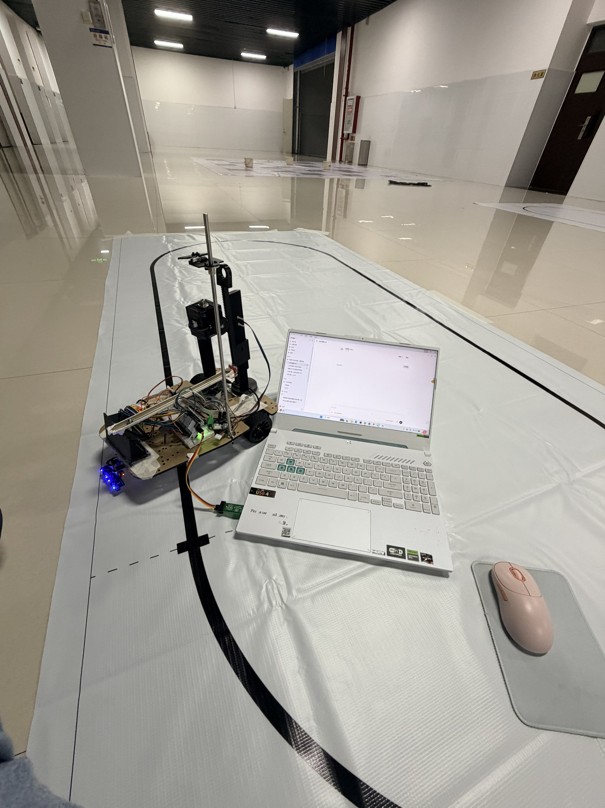
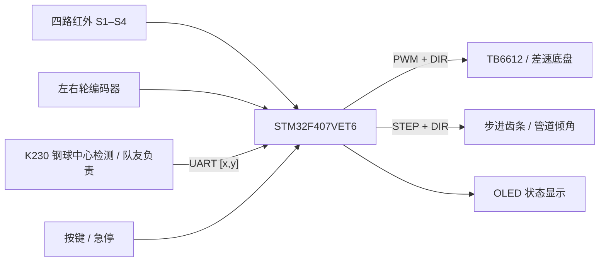

# 车载平衡滚球运动控制系统

**2026 河南省大学生电子设计竞赛 H 题 · STM32F407 嵌入式控制项目**

一台差速小车，同时包含地面红外循迹和车载单自由度滚球机构。本仓库保存完整工程、赛时历史版本、硬件接口、构建证据与设计报告，作为嵌入式软件方向的项目作品集。



<p align="center">实车调试现场：四路红外循迹、编码器差速底盘、单步进齿轮齿条机构与上方视觉支架。</p>

## 项目职责与技术栈

本人负责主控及非视觉模块：STM32 外设驱动、双轮编码器与速度 PI、红外循迹、步进电机执行、串口接收解析、OLED/按键交互、整车接线和联调。队友负责 K230 钢球识别、模型与图传；仓库中的视觉程序按团队协作资料归档，视觉训练成果不计入本人独立贡献。

| 模块 | 实现 |
|---|---|
| 最终主控 | STM32F407VET6，Keil MDK，ST-Link/SWD |
| 底盘 | TB6612 双路驱动、增量编码器、定时器 PWM、轮速 PI |
| 循迹 | 四路数字红外，离散状态解码、差速控制、速度斜坡、固定路线里程分段 |
| 滚球 | 250 mm 管道，单步进电机齿轮齿条调倾，位置/速度反馈与题3序列状态机 |
| 视觉接口 | K230 → USART2，9600 bit/s、8N1、RXNE 中断与环形缓冲 |
| 调试与保护 | OLED 版本号、按键、300 ms 收帧超时、急停、相对脉冲计数保护 |
| 早期方案 | MSPM0G3507、Code Composer Studio、SysConfig 与可复用控制模块 |

## 先看这几个文件

| 阅读目的 | 入口 |
|---|---|
| 当前滚球主程序 V17 | [app/main.c](H2026_STM32F407/STM32F407_ProjectTemplate/app/main.c) |
| 当前完整 Keil 工程 | [Project.uvprojx](H2026_STM32F407/STM32F407_ProjectTemplate/project/MDK(V5)/Project.uvprojx) |
| 四路循迹通用基线 | [main_stage41_4ch_line_v20_flowing_curve.c.saved](H2026_STM32F407/STM32F407_ProjectTemplate/app/main_stage41_4ch_line_v20_flowing_curve.c.saved) |
| 固定赛道循迹基线 | [main_stage49_v1_fixed_route.c.saved](H2026_STM32F407/STM32F407_ProjectTemplate/app/main_stage49_v1_fixed_route.c.saved) |
| 控制算法 | [control/](H2026_STM32F407/STM32F407_ProjectTemplate/control/) |
| 驱动层 | [bsp/](H2026_STM32F407/STM32F407_ProjectTemplate/bsp/) |
| 串口帧解析 | [protocol/](H2026_STM32F407/STM32F407_ProjectTemplate/protocol/) |
| 当前状态与实测边界 | [docs/current-state.md](docs/current-state.md) |
| 复现、编译和模式切换 | [docs/build-and-run.md](docs/build-and-run.md) |
| 面试讲解与贡献说明 | [docs/portfolio.md](docs/portfolio.md) |

## 系统结构



循迹与滚球在同一套 STM32 硬件上分阶段验证，采用不同的 `main` 入口。默认 `main.c` 为滚球 V17；**当前归档并未完成行驶循迹与滚球的同时闭环集成**。图中表示硬件关联，不代表默认固件同时启用全部模块。

## 有证据的结果

| 项目 | 赛时记录 | 状态 |
|---|---|---|
| 电机与编码器 | 左右轮前进计数均增加；正反转与双轮速度反馈完成测试 | 分模块验证 |
| 四路红外 | 白底 `0000`；单路分别 `1000/0100/0010/0001` | 顺序与极性验证 |
| 实车循迹 | 保守版约 50–51 s/圈；后期人工计时约 40 s/圈 | 能完成一圈，尚未达到题2的20 s |
| 视觉坐标 | 左端/中点/右端为 37/351/658 px，映射到 −125/0/+125 mm | 静态标定验证 |
| 题3滚球 | 实现 `0 → +50 → −50 mm` 序列及保护；终点仍有偏差和重复性问题 | 功能实验基线，未宣称达标 |
| V17 构建 | 历史日志：0 errors / 0 warnings，Code=19356 B | [原始构建记录](H2026_STM32F407/STM32F407_ProjectTemplate/stage78_v17_exact_restore_build.log) |

OLED 的 `D≈40420` 是编码器累计量，不是 40420 ms。`P/T` 是脉冲累计/目标命令，不是真实齿条位移反馈。更详细的错误归因、改进方向见 [工程复盘](docs/engineering-review.md)。

## 仓库内容

```text
H2026_STM32F407/   最终 STM32 工程、库依赖、历史入口及构建/烧录日志
car_final_ccs/    MSPM0 早期综合工程与模块文档
car_h2024_ccs/    MSPM0 H2024 复用工程
h2026_uart_protocol*/  历史协议与联调程序
k230_e2025/       早期视觉代码
vision_e2025/     离线视觉实验
offline_tools/   仿真、协议和引脚检查工具
交接包/           赛时整套交接快照，含 V17 固件和现有 K230 资料
咸鱼24电赛h/       原始工程、SDK 源码、厂商示例与参考资料
hardware/        红外模块例程与 PCB 参考
docs/            作品集说明、实测、照片、报告与来源清单
tools/           报告、接线图和 Gerber 检查脚本
```

所有已整理代码均以实际文件入库，未使用外部子模块。历史目录中的 README 可能描述当时的引脚或旧协议，以 [当前状态](docs/current-state.md) 和源码为准。目录来源、每文件 SHA256、排除项见 [归档说明](docs/archive-policy.md)。

第三方库和参考工程保留原始版权声明，见 [THIRD_PARTY_NOTICES.md](THIRD_PARTY_NOTICES.md)。本仓库未为整套第三方内容重新授予统一许可证。
