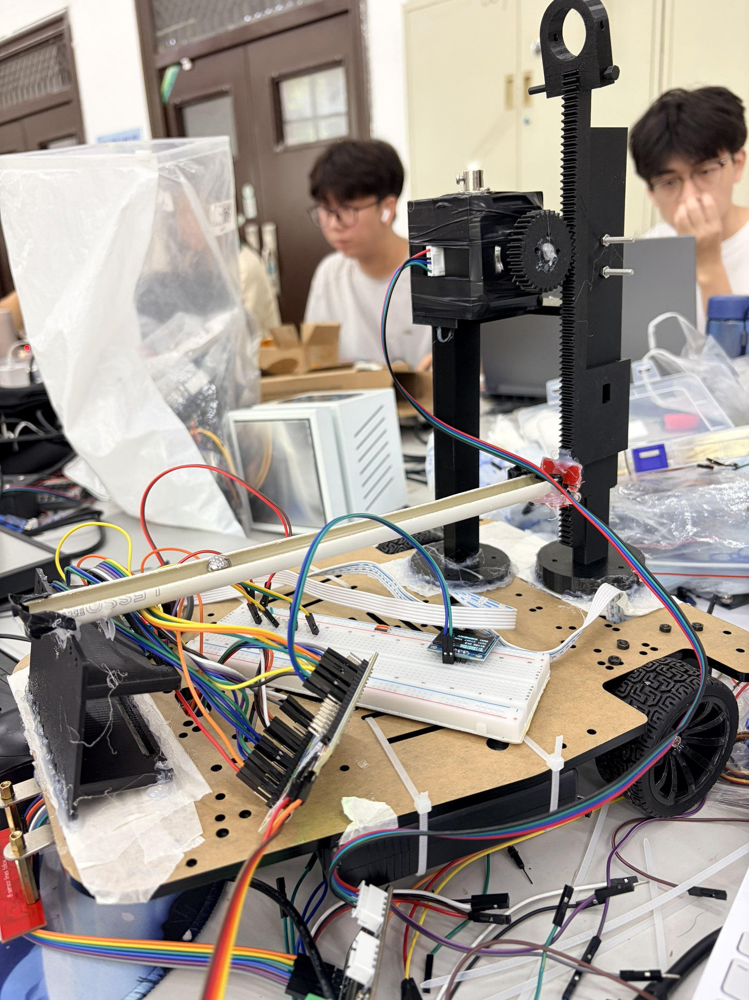

# 最终 STM32 硬件接口

| 模块 | 信号 | STM32F407 |
|---|---|---|
| 左轮TB6612 | PWMA / AIN1 / AIN2 | PE13(TIM1_CH3) / PD0 / PD1 |
| 右轮TB6612 | PWMB / BIN1 / BIN2 | PE14(TIM1_CH4) / PD2 / PD3 |
| TB6612 | STBY / VCC / GND | PD4 / 3V3 / 共地，VM接电机电源 |
| 左编码器 | A / B | PB4(TIM3_CH1) / PB5(TIM3_CH2) |
| 右编码器 | A / B | PB6(TIM4_CH1) / PB7(TIM4_CH2) |
| 四路数字红外 | S1 / S2 / S3 / S4 | PB1 / PB0 / PC5 / PC4 |
| 步进DCC-100 | STEP / DIR / SLP / RST | PA6 / PA7 / PA5 / PA4 |
| OLED软件I²C | SCL / SDA | PB10 / PB11 |
| 按键低电平有效 | SW1 / SW2 / SW3 / SW4 | PE7 / PE8 / PE9 / PE10 |
| K230单向UART | GPIO5/TX(40Pin第11脚) | PA3/USART2_RX，9600 8N1 |

红外、OLED使用3V3和公共GND。编码器输出需匹配0–3.3V逻辑。PB4用于编码器时采用SWD调试，勿占用该引脚做JTAG。

K230由稳定5V/USB-C供电，串口逻辑为3.3V，和STM32共地。步进驱动功率端独立供电，电压/电流按实际驱动、电机规格确认；控制GND与主控共地。当前程序主动控制SLP/RST，DCY未用。不要带电插拔步进电机相线。

管道长250 mm。车头端限制平移并允许绕横轴转动，车尾齿条升降改变纵向倾角。正脉冲→车尾上升→钢球向负x运动。图示为实际装配记录，不代表理想无回差机构。

首次调试先架空底盘、确认SW4能停止输出，再给功率侧上电。该机构没有原点/硬限位传感器，程序计数保护不替代机械防护。归档的JY61P/MPU6050仅用于临时机械标定；比赛正式球位置检测使用摄像头。
