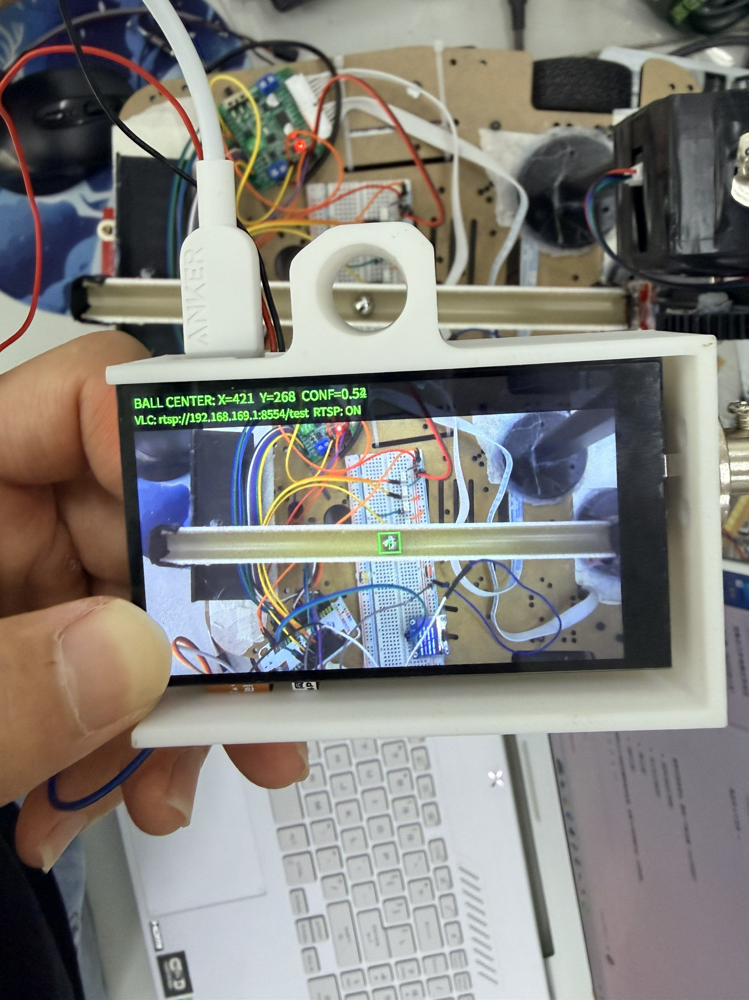
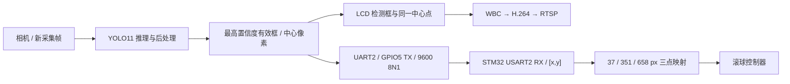

# 视觉子系统：K230 检球、图传与控制接口

视觉是整车系统的一部分：摄像头拍摄管道，YOLO检测钢球中心，K230同时提供LCD/RTSP画面并向STM32发送坐标。团队分工仍为队友负责视觉模型与图传，本人负责控制端接口和整车联调。

上图为用户提供的赛时识别画面，属于历史实测记录。下述整理版没有在本次归档过程中重新连接K230上板测试。

[STM32端接收画面](../docs/media/vision-uart-receiver.png)显示历史串口收帧与坐标诊断，便于对照整条链路。

## 阅读入口

| 内容 | 入口 |
|---|---|
| YOLO11 + LCD + RTSP + 当前ASCII接口整理版 | [k230/main.py](k230/main.py) |
| 最小UART发送模块 | [k230/vision_ascii_uart.py](k230/vision_ascii_uart.py) |
| 目标筛选与一致坐标 | [k230/target_selection.py](k230/target_selection.py) |
| 限帧WBC/H.264图传辅助模块 | [k230/SmoothWBCRtsp.py](k230/SmoothWBCRtsp.py) |
| TF卡目录、运行步骤与故障处理 | [部署说明](docs/deployment.md) |
| 当前/历史协议区别、坐标与标定 | [接口说明](docs/protocol.md) |
| 模型是否齐全、SHA256与来源 | [模型清单](models/README.md) |
| 现有数据集、训练和转换链 | [训练资料说明](docs/training.md) |
| 旧YOLOv8完整参考工程 | [原始项目](../咸鱼24电赛h/K230识别钢球-使用说明请看README/steel_ball_k230_open_source/) |
| 同学的最终接口交接说明 | [UART2通信交接说明](../交接包/H2026_整套代码与Codex交接_20260801/赛题与外部交接资料/H2026_K230_UART2_通信交接说明.md) |

## 数据路径

模型输入320×320、推理采集320×180、LCD坐标800×480；YOLO11备份库的后处理会把框转换到显示坐标。发送的是绝对像素中心，毫米转换保留在STM32。没有检测到球时不发送旧坐标，主控以300 ms无合法新帧判失效。

## 本次补齐与仍缺资料

- 原来的视觉文件已在整套交接包中，本次新增独立入口、部署文档、模型索引和接口测试。
- `k230/main.py`以现有`output/k230_deploy_gpio5_v2/main.py`为基础，保留检测和图传配置，将旧`115200 + [ball,...]`接口改为当前`9600 + [x,y]`。
- 本次整理版发送实际检测中心，不包含同学最终接口说明中的运动延迟预测模块；最终TF主程序没有读回，不能宣称完整恢复了其预测实现。
- YOLO11类别文件存在，但对应`yolo11_gq_320.kmodel`在当前本机归档中未找到。需从同学最终TF卡或其备份补齐，不能拿旧YOLOv8模型改名代替。
- 旧YOLOv8参考工程的PT、ONNX、KModel、图片/标签、训练曲线和转换脚本均已入库。它是参考模型，不作为最终YOLO11训练效果的证据。

运行`python tools/verify_vision_assets.py`可查看文件与权重状态。运行`python -m unittest discover -s tests -p 'test_vision*.py'`可执行无需硬件的接口测试。
